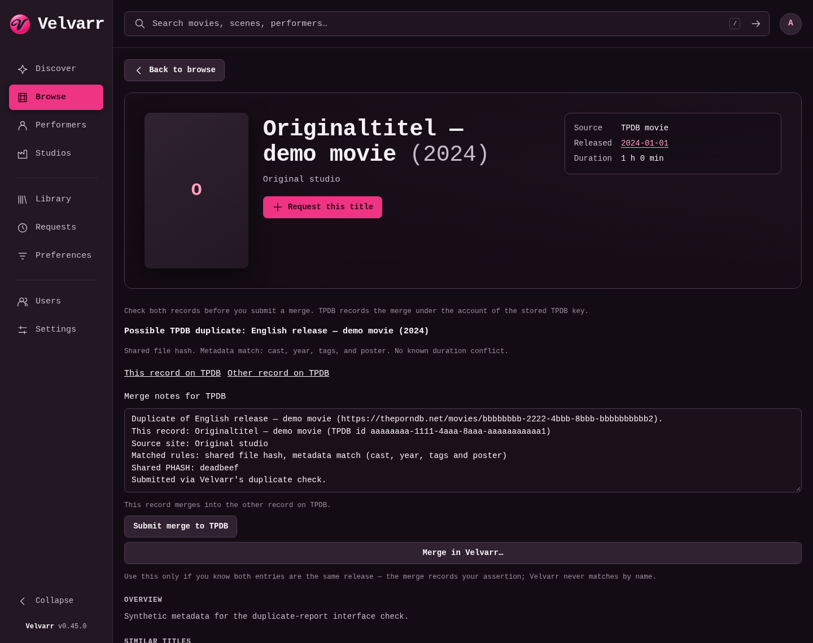

<p align="center">
  
</p>

<h1 align="center">Velvarr, the discovery and request app for adult media</h1>

<p align="center">
  <a href="#install">Install</a> &ensp;·&ensp;
  <a href="#quick-start">Quick start</a> &ensp;·&ensp;
  <a href="docs/how-it-works.md">Documentation</a> &ensp;·&ensp;
  <a href="https://github.com/Skare69/velvarr/releases">Releases</a>
</p>

<p align="center">
  <a href="https://github.com/Skare69/velvarr/actions/workflows/ci.yml"></a>
</p>

<p align="center">
  <a href="https://github.com/ottr-ai/ottr"></a>
</p>

---

Velvarr is an open source discovery and request app for adult media. Browse movies, scenes, performers, and studios from [TPDB](https://theporndb.net) and [StashDB](https://stashdb.org), request them into [Whisparr](https://whisparr.com) (Eros) with administrator approval, and watch in [Jellyfin](https://jellyfin.org) through a credential-free link.

A household member finds a title and sends one request. An administrator or moderator approves it, and Velvarr delivers it to Whisparr. When the file is in the library, each Jellyfin user gets a watch link that needs no Jellyfin sign-in.

## Install

Docker is the recommended way to run Velvarr. It uses [`compose.yaml`](compose.yaml) and the image `ghcr.io/skare69/velvarr`.

```sh
mkdir velvarr && cd velvarr
curl -fsSLO https://github.com/Skare69/velvarr/releases/latest/download/compose.yaml
touch .env.local && chmod 600 .env.local   # owner-only: the file holds the database key
printf 'VELVARR_SECRET_KEY=%s\nVELVARR_SETUP_SECRET=%s\n' \
  "$(openssl rand -hex 32)" "$(openssl rand -base64 32 | tr '+/' '-_' | tr -d '=')" > .env.local
docker compose up -d
```

> [!IMPORTANT]
> Back up `VELVARR_SECRET_KEY`. If you lose it, you cannot read the database or any backup.

[docs/install.md](docs/install.md) has the Windows commands, upgrades, health checks, and phone access. [docs/configuration.md](docs/configuration.md) lists every variable.

## Quick start

1. Open http://127.0.0.1:6699.
2. Enter `VELVARR_SETUP_SECRET` as the setup secret to create the owner account.
3. Save your TPDB token and StashDB key in Settings.
4. Browse, and request a title into Whisparr. An administrator or moderator approves it, or the account holds the auto-approve grant.
5. Open the approved title and watch it in Jellyfin through the credential-free link.

## Features

- Catalogs and one Browse grid across TPDB and StashDB: movies, scenes, performers, and studios, with filters that the URL holds.
- Requests with administrator or moderator approval, crash-safe acquisition into Whisparr, and per-user Jellyfin watch links. On Browse, "Request all" requests the titles that the grid shows, at most 20 for each press.
- Performer follows, per-account preferences, similar titles, and an update notice for new releases.
- Possible duplicate TPDB movies on the detail page, with evidence and a manual report to copy. Velvarr never submits reports to TPDB.
- Configure optional [Discord notifications](docs/configuration.md#discord-notifications) in Settings → Connections → Discord without a restart.
- Optional [Smarter library matching](docs/ai.md) and natural-language search.
  AI flags possible Jellyfin matches for administrator review, sorts similar titles, and suggests real search tags.

Movie detail with synthetic metadata:



## Learn more

- [Install](docs/install.md): every install variant, upgrades, health checks, and phone access.
- [Configuration](docs/configuration.md): every environment variable, origins and cookies, and sign-in limits.
- [Features](docs/features.md): the full feature list.
- [AI matching and natural-language search](docs/ai.md): Ollama decision models and searches in plain words.
- [Backup and recovery](docs/backup.md): consistent snapshots, restore, and file permissions.
- [Connection settings](docs/connections.md) and [metadata provider settings](docs/metadata-providers.md).
- [Testing](docs/testing.md): unit, API, and settings browser checks.
- [Development](docs/development.md): the development setup and the checks.
- [How Velvarr works](docs/how-it-works.md): the architecture, the request-to-playback flow, and the acquisition life cycle.

## How Velvarr is built

AI coding agents write the code, and no human reads it line by line. The maintainer, @Skare69, decides the features, writes the task for each change, and checks the running app. [Ottr](https://github.com/ottr-ai/ottr) runs the agents and the releases.

Automated checks and agent reviews do the code checks:

- Each change passes formatting, type checks, unit and API tests, and a production build before it reaches `main`.
- Each change that users can see gets a check in a real browser.
- Each release gets an agent review with mutation testing on the changed files. Architecture reviews also run the full mutation suite and a security audit.

AI-written code makes mistakes like any other code. Human code review is welcome: read [CONTRIBUTING.md](CONTRIBUTING.md), and open an issue or a pull request.

## Contribute

Build and change Velvarr from source. [CONTRIBUTING.md](CONTRIBUTING.md) tells you how to set up, run the checks, and open a pull request. Report a vulnerability as [SECURITY.md](SECURITY.md) tells you. Report an accessibility barrier as [ACCESSIBILITY.md](ACCESSIBILITY.md) tells you.

## License

Licensed under the [MIT License](LICENSE).
