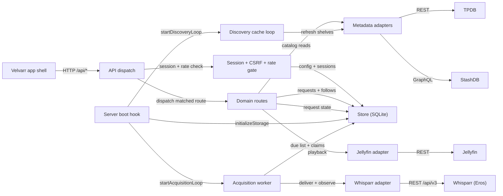
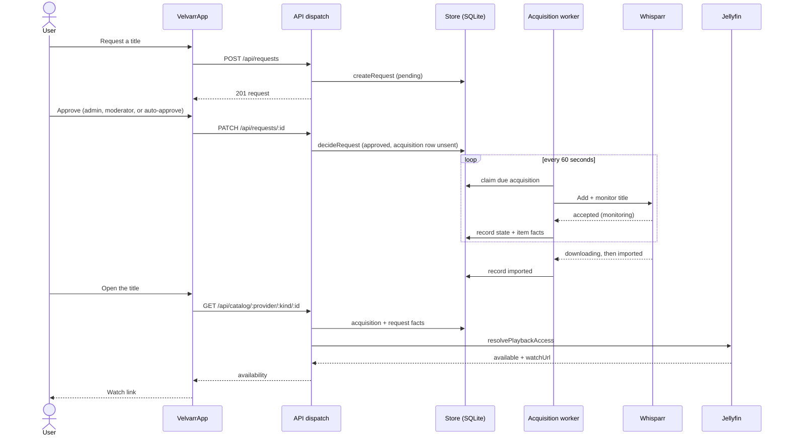
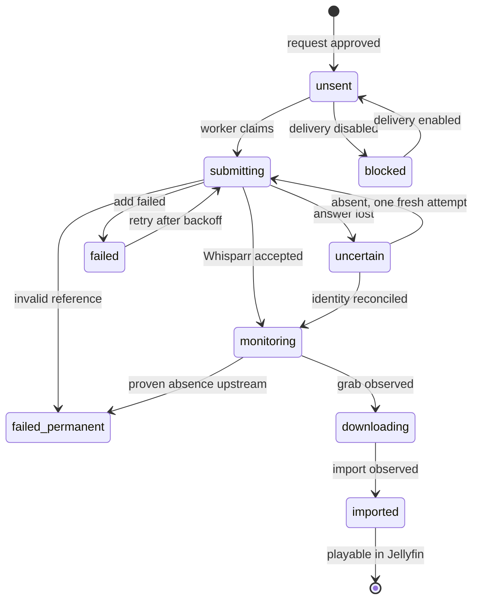

# How Velvarr works

Velvarr is a discovery and request app for adult media. Household members
browse movies, scenes, performers, and studios from two metadata providers
(TPDB and StashDB), request titles into Whisparr, and watch approved titles in
Jellyfin through a credential-free link. It is a single Next.js (Node 24)
process backed by one SQLite file: the UI, the JSON API, and two background
loops (acquisition and discovery) run in that one server. Administrators
approve requests; an acquisition worker records every delivery attempt in
SQLite before it touches the network, so a crash never loses or duplicates an
add.

## Architecture

- **Velvarr app shell** — `src/components/VelvarrApp.tsx` (views:
  discover, facets, titles, following, search, requests, library, admin,
  settings); the URL is the state (`?view=…`). Cards and hooks live in
  `src/components/shared.tsx`.
- **API dispatch** — `src/app/api/[...path]/route.ts`; exact matching over the
  folded route table, origin/CSRF gate before matching.
- **Session + CSRF + rate gate** — `src/app/api/[...path]/admission.ts`;
  session cookies, the request rate budget, and the `AuthContext` every
  handler receives. Credential decryption lives in
  `src/server/security.ts`, transport hardening in `src/server/http.ts`.
- **Domain routes** — `src/app/api/[...path]/routes/` (`auth.ts`,
  `requests.ts`, `follows.ts`, `catalog.ts`, `browse.ts`, `library.ts`,
  `admin.ts`, `discover.ts`); each exports `RouteDef[]`.
- **Metadata adapters** — `src/server/providers.ts` (TPDB REST, StashDB
  GraphQL) and `src/server/browse.ts` (grid filters); strictly read-only,
  pass-through, nothing persisted.
- **Store (SQLite)** — `src/server/storage.ts`; migrations and prepared
  statements. Tables: `config`, `accounts`, `sessions`,
  `catalog_identities`, `requests`, `acquisitions`,
  `performer_follows`, `discover_cache`. Credentials are encrypted with
  `VELVARR_SECRET_KEY`.
- **Acquisition worker** — `src/server/acquisition.ts`; 60 s cadence,
  20-item batches, claim tokens, and Discord notifications via
  `src/server/notify.ts`.
- **Whisparr adapter** — `src/server/whisparr.ts` (add, find by exact
  identity, observe).
- **Jellyfin adapter** — `src/server/jellyfin.ts` (auth, libraries,
  playback resolution).
- **Discovery cache loop** — `src/server/discovery.ts`; warms the
  `discover_cache` table so shelves render without waiting on providers.
- **Server boot hook** — `src/instrumentation.ts`; opens storage once,
  recovers abandoned work, starts both loops, handles SIGTERM/SIGINT.
- **TPDB** — theporndb.net (movies, scenes, performers, studios).
- **StashDB** — stashdb.org (scenes, performers, studios), GraphQL.
- **Whisparr (Eros)** — the acquisition manager at the operator's host.
- **Jellyfin** — the media server; also the identity provider (sign-in
  validates each user against Jellyfin).

## From request to playback

The main use case: a user requests a title, an approver lets it through, the
worker delivers it to Whisparr, and Jellyfin makes it watchable.

- **User** — a household member; admin and moderator accounts approve,
  any account can hold an `autoApprove` grant
  (`src/lib/approvals.ts`).
- **VelvarrApp** — `src/components/VelvarrApp.tsx`; request cards in
  `src/components/requests.tsx`.
- **API dispatch** — `src/app/api/[...path]/route.ts`; the request
  handlers live in `src/app/api/[...path]/routes/requests.ts`
  (`POST /api/requests`, `PATCH /api/requests/:id`).
- **Store (SQLite)** — `src/server/storage.ts` (`createRequest`,
  `decideRequest`); an active-intent unique index makes a request
  idempotent per account and title.
- **Acquisition worker** — `src/server/acquisition.ts`
  (`startAcquisitionLoop`); claims rows with compare-and-set tokens,
  records each attempt before the network call
  (`src/server/storage.ts`).
- **Whisparr** — `src/server/whisparr.ts` (`deliverToWhisparr`,
  `findWhisparrItem`, `observeWhisparrItem`).
- **Jellyfin** — `src/server/jellyfin.ts` (`resolvePlaybackAccess`);
  the verdict is per user: an exact match plus that user's authorization.

## Acquisition life cycle

Every approved request creates one shared acquisition row per Whisparr
instance and title identity. These are its states, from
`AcquisitionState` in `src/lib/contracts.ts`.

- **unsent** — approved but not yet delivered; the only state the add
  POST starts from. `src/server/storage.ts` (`decideRequest` inserts the
  row with this state, or `blocked`).
- **blocked** — delivery is disabled or unconfigured; not schedulable.
  `requeueBlocked` in `src/server/storage.ts` revives these rows when
  delivery is switched on.
- **submitting** — a worker holds the claim and the POST is in flight
  (`beginSubmission`).
- **uncertain** — the network answer was lost. Before any second POST the
  worker reconciles by exact identity (`reconcileUncertain` in
  `src/server/acquisition.ts`), so a retry can never duplicate an add.
- **monitoring** — Whisparr has the title and watches for a release; the
  steady state, never a failure.
- **downloading** — a grab is in flight, with Whisparr's own progress
  facts.
- **imported** — terminal; the file is in the library and per-user
  playback resolves against Jellyfin.
- **failed** — a failed add that may still succeed; retried with
  backoff (schedulable in `src/server/storage.ts`).
- **failed_permanent** — terminal: an invalid reference, an identity
  mismatch, or a proven upstream absence (`recordAbsence`).

The user-facing badge folds these states through one precedence ladder in
`src/lib/status.ts` (`acquisitionPhase`, `statusOf`): available beats
processing beats paused beats the request decision.
